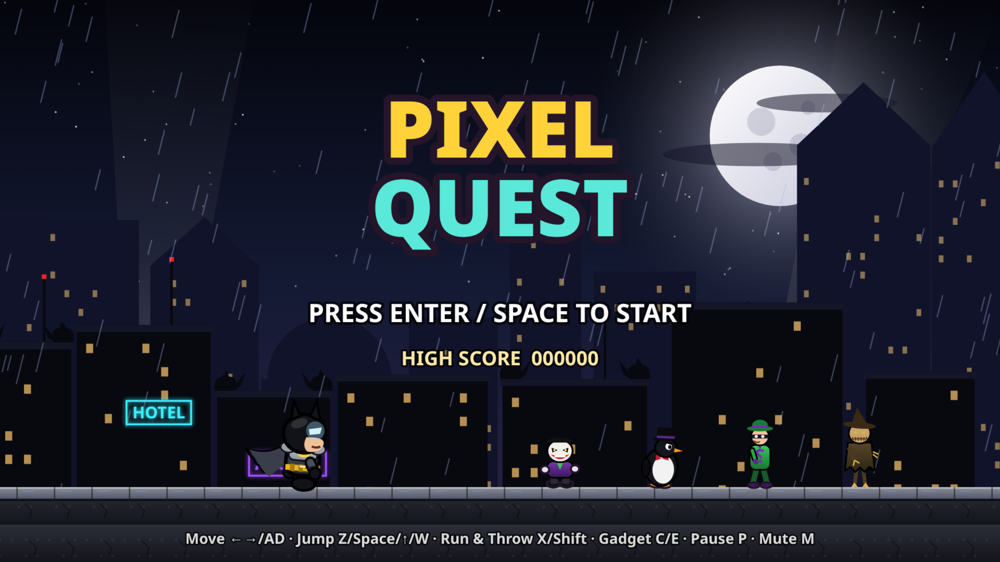
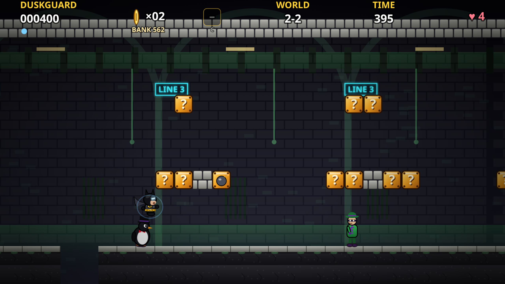
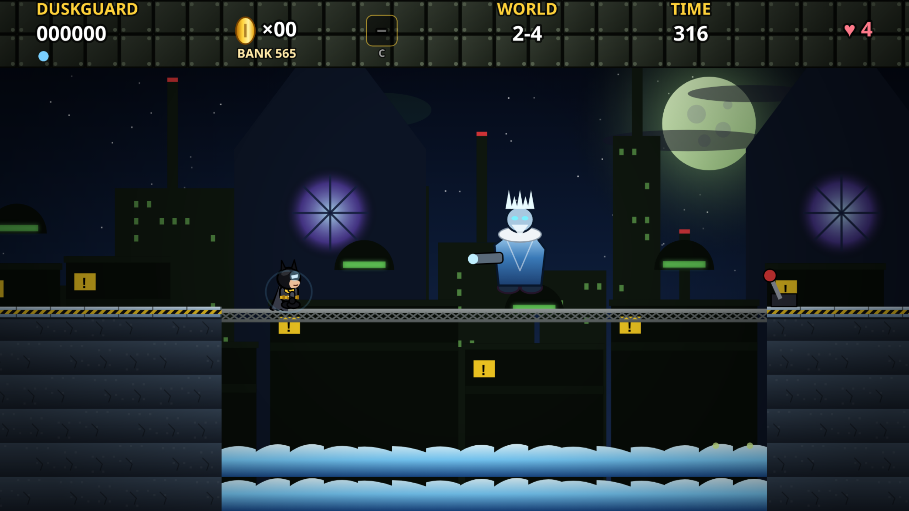
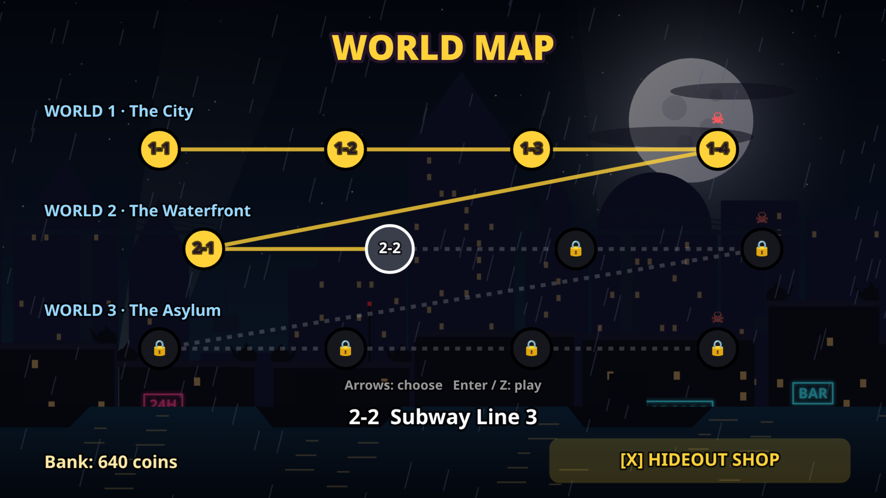
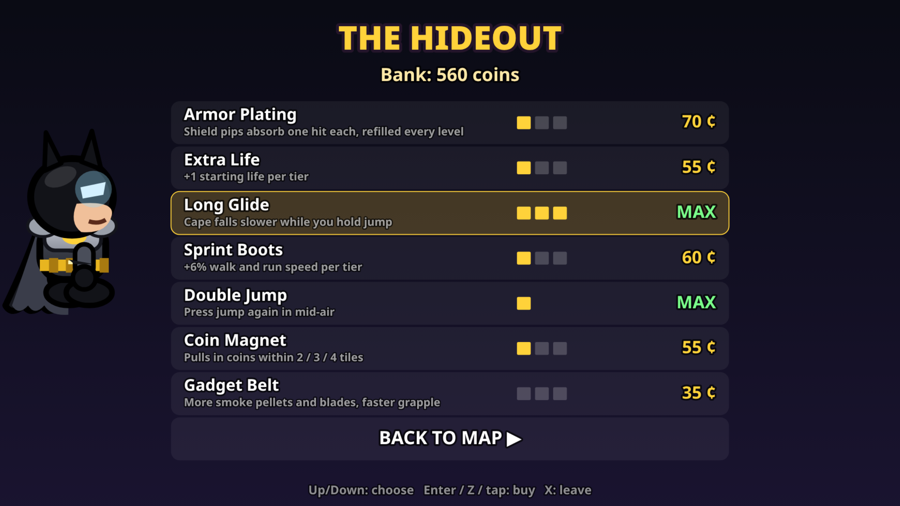

# Pixel Quest

An original side-scrolling platformer inspired by classic 1985-era platform games. It's a single HTML5 canvas file with no libraries, and all of its art and music are original and procedurally drawn or composed.

**Play:** https://jaywalker16.github.io/pixel-quest/

## Features
- Momentum-based running with skidding, variable jump height, coyote time and jump buffering
- Fixed 60 Hz simulation with render interpolation and a smooth camera that looks ahead
- High-DPI vector-style art: Duskguard, an original caped vigilante with a spring-physics cape that flutters and lets you glide slightly if you hold jump while falling,, a rival gang: grin-mask thugs, belly-sliding tuxedo bird-thugs (the kickable shell), question-mark puzzlers with boomerangs, fear-gas scarecrows, and a giggling chemical clown king boss
- ? blocks, breakable bricks, Sproutcap (grow), Ember Bloom (fireballs), Prism Star (invincibility), 1-ups, and 100 coins for an extra life
- A dark gothic city at night with parallax skylines, gargoyles, rain, searchlights, neon and a big moon. Worlds 1-1 to 1-4: city streets, sewers with a bonus pipe, rooftops with lifts, and a chemical factory with spark bars, a toxic vat, the boss and a bridge lever
- Chiptune music and sound effects, a title screen, pause, and a high score saved in localStorage
- Keyboard, touch and gamepad controls

## Controls
| Action | Keys |
|---|---|
| Move | Arrow keys / A, D |
| Duck / enter pipe | Down / S |
| Glide | Hold jump while falling |
| Jump | Z / Space / Up / W |
| Run / fire | X / Shift |
| Pause | P / Esc |
| Mute | M |

## Worlds, Hideout & Gadgets (v4)
- **12 levels / 3 worlds**: The City, The Waterfront (Docks, Subway, Amusement Park, Frozen Cathedral — boss: the frost-gun villain), The Asylum (Grounds, Cell Block, Clocktower, Greenhouse — boss: the vine villain). Difficulty rises each world.
- **World map** with saved progress (localStorage) and **mid-level checkpoint lamps**.
- **Coin bank + Hideout shop** between levels: Armor, Extra Life, Glide, Run, Double Jump, Magnet, Gadget Belt (tiered). All upgrades cost 1290 coins; ~595 coins exist across the 12 levels, so maxing out takes about two playthroughs.
- **100-coin 1-up kept**: coins still count toward the classic in-level 1-up *and* go into the bank, so neither reward is lost.
- **Gadgets**: Armor Suit, Throwing Stars (crescent blades), Shadow Mode, Grapple Gun (auto-targets nearest anchor/ledge), Smoke Pellets (stun enemies). Icons on ? blocks, HUD gadget slot.
- **Controls**: C / E (gamepad Y, touch "G") = use gadget. Arrow keys/WASD move, Up/W/Space jump, Shift run, P pause.
- **Install as an app**: open the page on your phone → "Add to Home Screen". Runs full-screen landscape and works offline (service worker).

 
